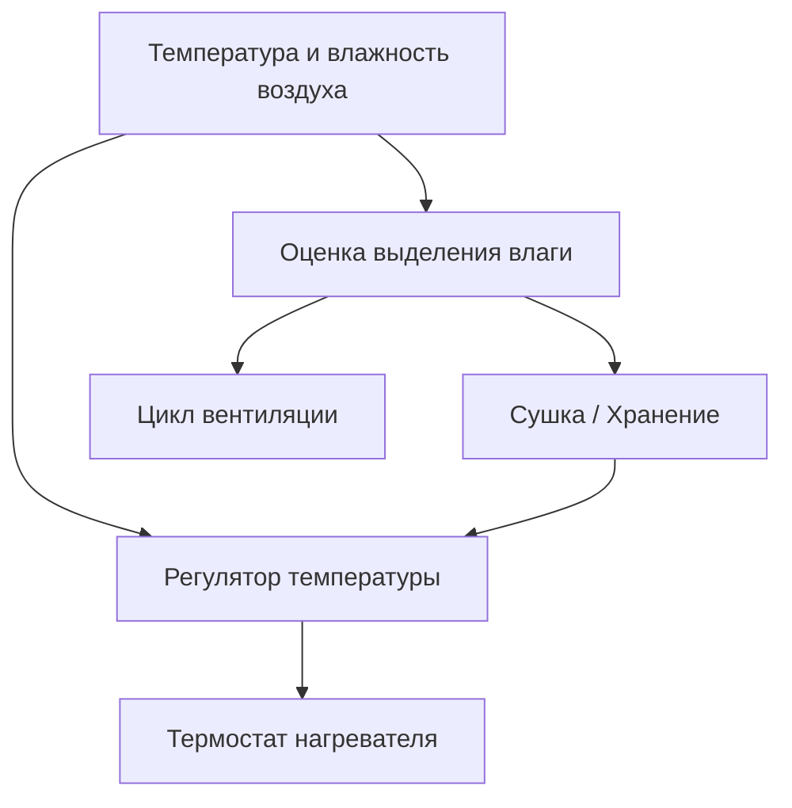
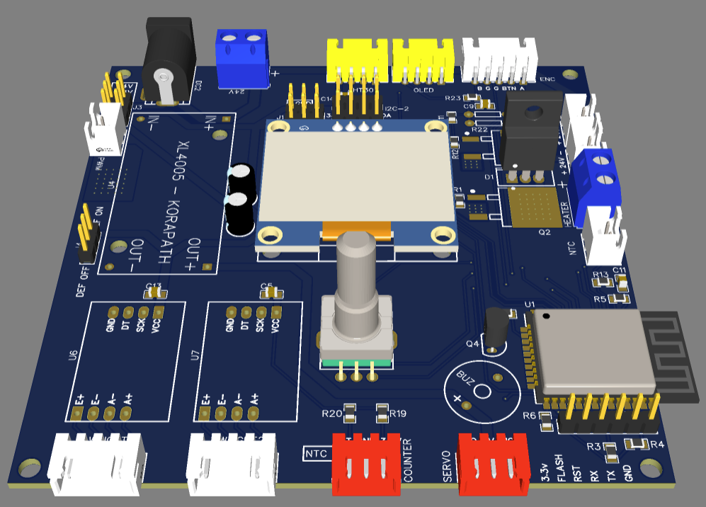
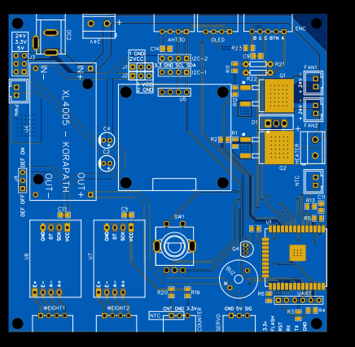
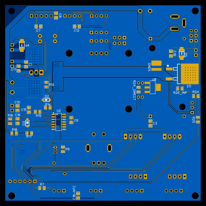

# FilamentDryer

[](https://github.com/mzaprudin/FilamentDryer/actions/workflows/ci.yml)

[English version](README.md)

**Статус: прототип на макетной плате проверен, печатная плата разведена (готова к изготовлению)**

Прошивка сушилки для двух катушек филамента на ESP32. Она нагревает камеру,
оценивает выделение влаги по воздуху и переходит на температуру хранения, когда
выполнен критерий сушки или достигнуто максимальное время пресета. При хранении
устройство может обнаружить новую влагу и запустить досушку.

Сушилка работает без Wi-Fi: управление доступно с OLED-экрана и энкодера.
Веб-панель даёт доступ к управлению, телеметрии, калибровке весов и обновлению
прошивки. Версия прошивки: **0.2.2**.



## Инженерные решения

- **Оценка выделения влаги.** Абсолютная влажность выражает количество водяного
  пара в г/м³. Её рост в закрытой камере служит сигналом для оценки сушки.
  Короткие продувки обновляют воздух; после стабилизации измерения возобновляются.
- **Несколько подтверждений.** Два спокойных измерительных окна и минимальное
  время сушки пресета разрешают переход в `Hold` — хранение. Окна завершаются
  также по времени, поэтому ровная влажность позволяет закончить сушку при
  закрытой заслонке. В `Hold` спокойное окно и следующее за ним влажное окно
  разрешают досушку.
- **Два температурных контура.** PID-регулятор температуры воздуха задаёт
  температуру нагревателя. Внутренний термостат включает и выключает нагрев
  вокруг этой уставки, с запасом до настроенного предела.
- **Сначала команда вентилятору.** Перед командой нагрева прошивка задаёт
  вентилятору уровень не ниже настроенного минимума. Дополнительную защиту дают
  проверки температур и отдельный термопредохранитель.

Оборудование: ESP32-WROOM-32D, датчик воздуха AHT30, термистор NTC нагревателя,
двое весов с HX711, PTC-нагреватель на 24 В, вентиляторы и заслонка с сервоприводом.
Весы показывают массу катушек; для оценки выделения влаги используется датчик воздуха.

## Печатная плата



| Верх | Низ |
|---|---|
| [](docs/assets/pcb-top.svg) | [](docs/assets/pcb-bottom.svg) |

## Сборка и запуск

После установки PlatformIO Core 6.2.0, из корня репозитория:

```sh
pio test -e native
pio run -e esp32dev
pio run -e esp32dev -t upload
pio run -e esp32dev -t uploadfs
```

Версии инструментов заданы в [requirements-dev.txt](requirements-dev.txt).
Последняя команда устанавливает веб-панель. Настройка Wi-Fi включается на
устройстве через `WIFI SETUP → Start`; пароль точки доступа показан на экране.
После настройки панель доступна по адресу `http://dryer.local`.

37 нативных тестов проверяют блокировку нагрева по команде вентилятора,
температурный каскад, цикл вентиляции, регрессию влажности и переходы автомата.
CI также запускает 14 Python-тестов телеметрии и собирает обе прошивки с образом
LittleFS. Отчёты и образы доступны в артефактах проверок.

В [архитектуре](docs/ARCHITECTURE.RU.md) описаны подключение, управление, API и
обновление по Wi-Fi. [Руководство по измерениям](docs/MEASUREMENTS.RU.md) объясняет,
как записать реальный цикл и построить графики температур, влажности, вентиляции
и перехода в `Hold`. Начальные пороги сухости требуют калибровки на реальных катушках.

[Лицензия MIT](LICENSE).
