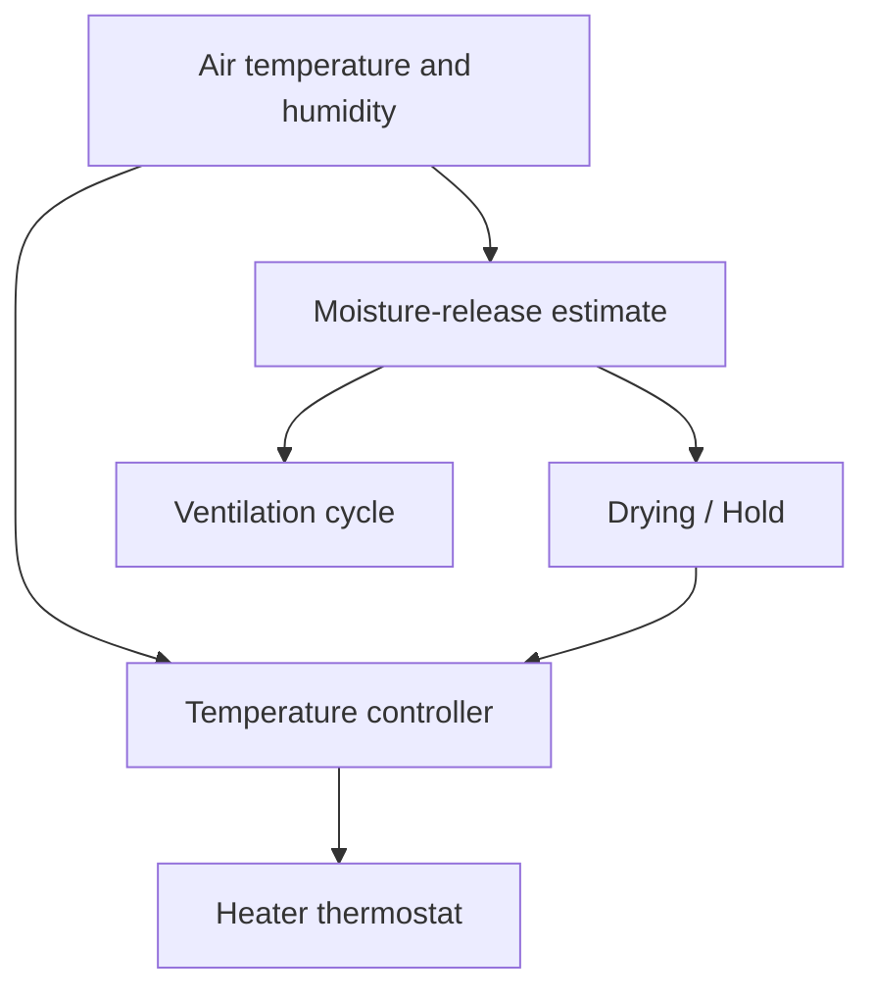

# FilamentDryer

[](https://github.com/mzaprudin/FilamentDryer/actions/workflows/ci.yml)

[Русская версия](README.RU.md)

Firmware for an ESP32 dryer with two filament spools. It heats the chamber,
estimates moisture release from the air, and moves to a lower storage temperature
when the preset's drying criterion or maximum time is reached. During storage it
can detect new moisture and start another drying cycle.

The device works from an OLED screen and rotary encoder without Wi-Fi. A web
panel provides control, telemetry, weight calibration and firmware updates.
Firmware version: **0.2.2**.



## Engineering decisions

- **Measure moisture release.** Absolute humidity expresses water vapour in
  g/m³. Its rise in the closed chamber gives a drying signal. Short ventilation
  pulses exchange the air; measurements resume after the chamber settles.
- **Require repeated evidence.** Two quiet measurement windows and the preset's
  minimum drying time permit `Hold`. Windows also end by time, so flat humidity
  can complete drying while the vent stays closed. In `Hold`, a quiet window
  followed by a new wet window permits another drying cycle.
- **Control air and heater separately.** An air-temperature PID sets the heater's
  target temperature. An inner thermostat switches the heater on and off around
  that target, with a ceiling below its configured limit.
- **Apply fan commands first.** The actuator layer raises fan duty to its minimum
  whenever heating is requested, then applies the heater command. Temperature
  checks and a separate thermal fuse provide further protection.

Hardware: ESP32-WROOM-32D, AHT30 air sensor, heater NTC thermistor, two HX711 load
cells, a 24 V PTC heater, fans and a servo vent. Weight readings support spool
monitoring; the moisture estimate uses the air sensor.

## Build and run

With PlatformIO Core 6.2.0 installed, from the repository root:

```sh
pio test -e native
pio run -e esp32dev
pio run -e esp32dev -t upload
pio run -e esp32dev -t uploadfs
```

Pinned development tools are listed in [requirements-dev.txt](requirements-dev.txt).
The last command installs the web panel. Wi-Fi setup opens from `WIFI SETUP →
Start` on the device; the screen shows the hotspot password. After setup, the
panel is available at `http://dryer.local`.

The 37 native tests cover the fan interlock, temperature cascade, ventilation
cycle, humidity regression and drying-state transitions. CI also runs 14 Python
telemetry tests and builds both firmware profiles and LittleFS. Reports and
firmware images are available as workflow artifacts.

[Architecture](docs/ARCHITECTURE.md) contains wiring, control details, API and OTA
instructions. [Measurements](docs/MEASUREMENTS.md) explains how to capture a real
cycle and plot temperatures, humidity, ventilation and the transition to `Hold`.
The initial dryness thresholds are parameters for calibration on real spools.

[MIT license](LICENSE).
