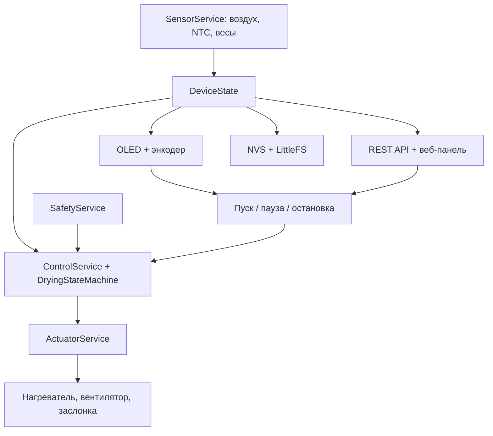
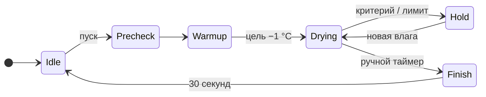

# Архитектура FilamentDryer

[English version](ARCHITECTURE.md) · [Обзор проекта](../README.RU.md) ·
[Измерения](MEASUREMENTS.RU.md)

Документ описывает прошивку **0.2.2** для ESP32-WROOM-32D. Камера вмещает две
катушки; управление температурой и влажностью использует общее состояние с
локальным экраном и веб-панелью. Доступность Wi-Fi не определяет режим сушки.

## Оборудование и показания

Распиновка задана в [BoardConfig.h](../include/config/BoardConfig.h).

| Функция | GPIO | Реализация |
|---|---:|---|
| I²C SDA / SCL | 21 / 22 | AHT30 по `0x38`, SH1106 по `0x3C`, 400 кГц |
| Энкодер A / B / кнопка | 32 / 33 / 25 | локальное меню |
| MOSFET нагревателя | 26 | PTC на 24 В, включение/выключение термостатом |
| MOSFET вентиляторов | 27 | два вентилятора на 24 В, PWM 20 кГц, 10 бит |
| Сервопривод заслонки | 14 | отдельное питание 5–6 В, 50 Гц |
| NTC нагревателя | 34 | ADC1, 10 кОм при 25 °C, Beta 3950 |
| HX711 №1 DOUT / SCK | 16 / 17 | первая катушка |
| HX711 №2 DOUT / SCK | 18 / 19 | вторая катушка |

Схема предусматривает термопредохранитель на 120 °C последовательно с
нагревателем. Подтяжки затворов MOSFET к земле удерживают силовые выходы
выключенными при сбросе ESP32.

Делитель NTC подключён как `3,3 В → постоянный резистор → ADC → NTC → земля`.
Драйвер использует постоянный резистор **3,6 кОм**, режим `ADC_11db` и отношение
из `analogRead()`:

```text
r = raw / 4095
R_NTC = 3600 × r / (1 − r)
T_K = 1 / (1 / 298.15 + ln(R_NTC / 10000) / 3950)
T_C = T_K − 273.15
```

Крайние значения ADC и температура вне принятого драйвером диапазона дают
невалидное показание. Эти параметры конструктора заданы в
[Defaults.h](../include/config/Defaults.h). Показание AHT30 содержит температуру,
относительную и абсолютную влажность, а также признак валидности. Для каждого
HX711 медиана восьми показаний предшествует преобразованию в граммы.

## Сервисы и расписание

`src/main.cpp` собирает драйверы, сервисы и общий объект `DeviceState`. Драйверы
реализуют интерфейсы из `include/domain/Interfaces.h`; это позволяет запускать
ядро управления на компьютере с тестовыми исполнительными механизмами.



Основной цикл задаёт следующие номинальные периоды:

| Работа | Период |
|---|---:|
| Опрос NTC и весов | 100 мс |
| Управление, калибровка, применение выходов | 100 мс |
| Опрос датчика воздуха | 1 с |
| Обновление локального экрана | 250 мс |
| Отсчёты AH внутри подходящего окна | 30 с |
| Телеметрия LittleFS | 60 с |
| Диагностика в serial | 5 с |

Локальный ввод, Wi-Fi, ArduinoOTA и HTTP-сервер обслуживаются в том же цикле.
Их вызовы делят задачу с регулятором. Watchdog задачи настроен на пять секунд.

## Каскад температуры

Внешний регулятор получает температуру воздуха камеры и выдаёт **уставку
температуры нагревателя**. Внутренний термостат сравнивает её с NTC нагревателя и
запрашивает 0% либо 100% нагрева.

Действующая цель воздуха — температура сушки или положительная
`holdTemperatureC` в `Hold`. Обычный потолок нагревателя равен меньшему
положительному пределу пресета и конфигурации минус 5 °C. `ControlService` также
оставляет потолок хотя бы на 1 °C выше цели воздуха, чтобы у PID был диапазон
выхода.

Собственный `PidController` ограничивает выход и интеграл, считает производную
по входу и предотвращает накопление интеграла при насыщении. Изменение
температурного диапазона сбрасывает PID и термостат. У термостата полоса ±1 °C и
минимальный интервал переключения две секунды; защита может независимо снять
запрос нагрева.

## Импульсная вентиляция

`PurgeScheduler` проходит три фазы. Числовые значения передаются также в
`dryness.purgePhase` через API.

| Фаза | Значение | Заслонка | Запрос вентилятора |
|---|---:|---|---|
| `Sealed` | 0 | закрыта | циркуляционный режим |
| `Purge` | 2 | открыта | режим продувки |
| `Settle` | 1 | открыта | режим продувки |

После минимального закрытого интервала продувка начинается, если AH выросла
хотя бы на **0,5 г/м³** от исходного уровня закрытой фазы или достигла
`AH(действующая цель воздуха, целевая RH) + 3 г/м³`. Первую продувку можно
начать сразу для обмена исходного воздуха.

`Purge` заканчивается, когда AH опускается ниже второго порога или истекает
предельная длительность продувки. В `Settle` заслонка остаётся открытой заданное
время, затем закрывается и фиксируется новый исходный уровень AH. Комментарии
первоначального проекта описывали закрытую фазу стабилизации; действующая
политика выходов держит заслонку открытой.

При активном управлении заполнение PWM вентилятора составляет не меньше
настроенного минимума и 25%. Расписание вентиляции работает независимо от
временного завершения измерительного окна AH.

## Измерение выделения влаги

Абсолютная влажность (AH) выражает количество водяного пара в г/м³. В закрытой
камере при близкой к постоянной температуре скорость её изменения позволяет
оценить выделение влаги филаментом. `HumidityMath` преобразует температуру и
относительную влажность AHT30 через давление насыщенного пара и уравнение
идеального газа.

`AhSlopeEstimator` строит линейную регрессию AH по времени и выдаёт наклон в
г/м³/ч. Он хранит до 40 отсчётов и при расчёте использует время относительно
последнего отсчёта.

Для подходящего окна нужны `Drying` или `Hold`, закрытая заслонка и температура
воздуха в пределах ±1 °C от действующей цели. Первый отсчёт берётся сразу,
следующие — каждые 30 секунд. Для наклона нужны минимум восемь отсчётов за
период не короче 210 секунд.

```text
длительность окна = max(minSealSeconds × 1000, 7 × 30000) миллисекунд
спокойное окно    = валидный наклон < drynessSlopeGm3PerHour
влажное окно      = валидный наклон ≥ drynessSlopeGm3PerHour
```

Окончание заданного времени завершает подходящее окно без открытия заслонки.
Реальный переход `Sealed → Purge` также может завершить окно с достаточным
числом отсчётов. Совпавшие события дают одну оценку. Спокойная оценка увеличивает
`drynessChecks`, влажная — обнуляет его. Незавершённые окна результата не дают.
Сама вентиляция сохраняет уже полученные подтверждения.

Выход температуры за границы, открытие заслонки или пауза прерывают
незавершённое окно. Новый запуск и переход между `Drying` и `Hold` сбрасывают
измерения и счётчик последовательных окон. Поэтому отсчёты прогрева и охлаждения
не переносятся в следующий температурный режим.

Начальный порог пресетов — **0,3 г/м³/ч**. Он и интервалы служат исходными
значениями для [процедуры измерений](MEASUREMENTS.RU.md). Вес катушек относится к
дополнительной телеметрии и для этого критерия не требуется.

## Режимы и переходы

Основные переходы реализованы в
[DryingStateMachine.cpp](../src/core/DryingStateMachine.cpp).



- **Пресет:** минимальное время сушки и два последовательных спокойных окна
  разрешают `Hold`. Максимальное время также переводит в `Hold`. Время
  отсчитывается после прогрева, без учёта пауз.
- **Hold:** цель воздуха снижается до температуры хранения. Новое спокойное
  окно включает ожидание влаги; следующее влажное окно запрашивает новый цикл
  сушки. Прежний нулевой счётчик сам по себе цикл не запускает. Нулевой порог
  сухости отключает и раннее завершение, и автоматическую досушку.
- **Ручной режим:** отсчёт заканчивается в `Finish` независимо от счётчика сухости.
- **Постоянный режим:** условия поддерживаются до команды остановки.
- **Пауза:** запоминает `Warmup`, `Drying` или `Hold` для продолжения;
  незавершённое измерительное окно отбрасывается.
- **Остановка:** выбирает `Cooldown`, затем через 30 секунд — `Idle`. Новый
  явный запуск выбирает `Precheck` и очищает предыдущую аварию.

`Calibration` — внутренний режим сервиса калибровки весов. Материалы и
минимальная/максимальная длительность пресетов заданы в
[AppConfig.cpp](../src/config/AppConfig.cpp). `GET /api/config` возвращает их
список; изменение таблицы требует пересборки прошивки.

## Выходы и защита

`SafetyService` проверяет валидность и конечность показаний воздуха и нагревателя,
предел нагревателя и потолок температуры воздуха. Отсутствие весов не блокирует
нагрев. Исходные пределы — 105 °C для нагревателя и 75 °C для воздуха.

`ActuatorService` применяет команду вентилятора перед командой нагревателя. При
запросе нагрева он поднимает заполнение PWM вентилятора до минимума, заданного
при инициализации. Это программное свойство команд; обратной связи по потоку
воздуха в оборудовании нет.

| Ситуация | Нагреватель | Вентилятор | Заслонка |
|---|---:|---:|---|
| `Idle`, `Paused`, установленный `Fault` | выключен | выключен | безопасный угол |
| `Finish`, `Cooldown` | выключен | 60% | безопасный угол |
| Проверка защиты обнаружила аварию | выключен | 100% на этом шаге | безопасный угол |
| Регулятор видит выполняющееся OTA | выключен | 60% | безопасный угол |

На следующем шаге после обнаружения аварии действует политика установленного
`Fault`. Независимый термопредохранитель и подтяжки затворов относятся к
аппаратной части. Перечень аварий содержит и запланированные случаи: текущая
проверка защиты не реализует тайм-аут прогрева и не переводит ошибки хранения
в аварию.

## Веб-API и хранение

Оба интерфейса используют один автомат. Обработчики API передают команды
сервисам, отдельного алгоритма управления у веб-панели нет.

| Метод и путь | Поведение |
|---|---|
| `GET /api/state` | полное текущее состояние, версия, показания, уставки, выходы и сухость |
| `GET /api/config` | доступные настройки и встроенные пресеты; без паролей |
| `PUT /api/config` | доступные настройки сети, входа, времени, температур, вентилятора и весов |
| `POST /api/run` | запуск пресета, ручного или постоянного режима |
| `POST /api/pause` | переключение паузы/продолжения |
| `POST /api/stop` | остановка и охлаждение |
| `GET /api/history` | текущий файл телеметрии JSONL |
| `GET /api/events` | текущий файл событий JSONL |
| `GET/POST /api/calibration` | состояние весов или операция tare/scale/drift |
| `GET /api/scan` | запуск или получение результата асинхронного поиска Wi-Fi |
| `POST /api/reboot` | перезапуск |
| `POST /api/ota` | загрузка прошивки multipart-запросом |

Примеры тела запуска: `{"mode":"timed_preset","preset":"pla"}` и
`{"mode":"timed_manual","temperatureC":45,"durationSeconds":21600}`.
Изменения конфигурации сохраняются, ответ содержит `rebootRequired`; перезапуск
завершает применение настроек, используемых при инициализации. Пороги сухости и
интервалы пресетов через этот обработчик не изменяются.

Preferences/NVS хранит отдельные ключи конфигурации и две таблицы компенсации
весов. Текущий режим, ожидающие события увлажнения и измерительные окна остаются
в RAM. Сервис хранения переносит первоначальный бинарный блок конфигурации в
формат отдельных ключей.

LittleFS содержит ресурсы панели, `/telemetry.jsonl` и `/events.jsonl`. При
300 000 байт каждый журнал ротируется в один файл `.old`. Обработчики истории и
событий возвращают текущие файлы целиком. Телеметрия записывается каждые 60 секунд
и содержит `ts`, необязательный `epoch`, `t`, `rh`, `ah`, `ntc`, `w1`, `w2`,
`heat`, `fan`, `vent`, `pph` и `slope`. Для экспериментов используется запись
полного состояния: в ней есть также фаза сушки, число отсчётов наклона и счётчик
спокойных окон.

## Сеть, первая настройка и OTA

Без сохранённой сети Wi-Fi выключен; при наличии учётных данных станция
подключается и повторяет попытки независимо от режима сушки. `WIFI SETUP → Start`
или удержание кнопки энкодера при включении открывает `dryer-setup-XXXX`.
Случайный WPA2-пароль действует до перезапуска и показан на экране и в serial.
Настройка работает десять минут; новый запрос продлевает окно. Страница
настройки доступна по адресу `http://192.168.4.1`.

В домашней сети адрес по умолчанию — `http://dryer.local`. После синхронизации
NTP добавляются Unix-метки времени; исходный сдвиг отображения — UTC+3.
Пустой веб-пароль оставляет локальную панель и OTA открытыми. Заданный пароль
включает HTTP Basic аутентификацию, с `admin` как логином по умолчанию, и
защищает ArduinoOTA.

Для разработки используется PlatformIO Core 6.2.0. В виртуальном окружении
Python 3.11+ команда `python -m pip install -r requirements-dev.txt` устанавливает
закреплённые инструменты сборки и графиков. Первая установка загружает и прошивку,
и ресурсы панели:

```sh
pio run -e esp32dev -t upload
pio run -e esp32dev -t uploadfs
```

Дальнейшие обновления прошивки доступны через панель или ArduinoOTA:

```sh
pio run -e esp32dev_ota -t upload
pio run -e esp32dev_ota -t upload --upload-port 192.168.1.238
```

Для ArduinoOTA с паролем локальная конфигурация PlatformIO передаёт аргумент
`--auth` загрузчику через `upload_flags`. Веб-панель принимает `firmware.bin`
multipart-запросом. Передача ArduinoOTA блокирует задачу: обработчики временно
снимают её с watchdog и возвращают после завершения или ошибки. Признак OTA
приостанавливает запись телеметрии в LittleFS на время передачи.

[Разметка 4 МБ](../partitions_ota_4mb.csv) содержит два слота приложения и
LittleFS. Автоматическое подтверждение загрузки и откат входили в первоначальный
проект; действующая прошивка использует описанные выше механизмы Arduino OTA.

## Проверки и история решений

Нативные тесты в [test_logic.cpp](../test/test_native/test_logic.cpp) проверяют
преобразование и регрессию влажности, границы температур, переключения
термостата, порядок команд вентилятора, интервалы продувки и переходы автомата.
Python-тесты проверяют запись через локальный HTTP-сервер и графики на
синтетических данных. CI также собирает оба обычных профиля прошивки и образ
LittleFS. Профиль `esp32dev_test` отключает проверки NTC для стендовых работ и
исключён из распространяемых образов.

Первоначальная архитектура предлагала PID мощности нагревателя, PID относительной
влажности, QuickPID/HX711_ADC и завершение по таймеру. Реализация использует
собственный PID с термостатом нагревателя, импульсную вентиляцию, bogde/HX711 и
критерий AH с наблюдением при хранении. Версия 0.2.2 отделяет завершение
измерительного окна от продувок и запускает досушку по новым измерениям в `Hold`.
