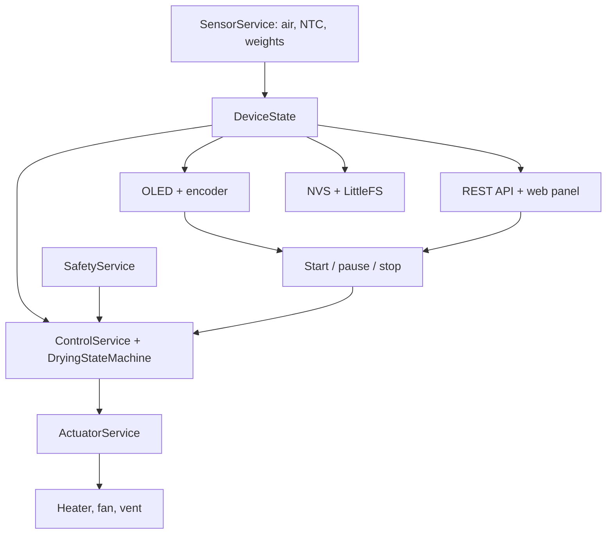
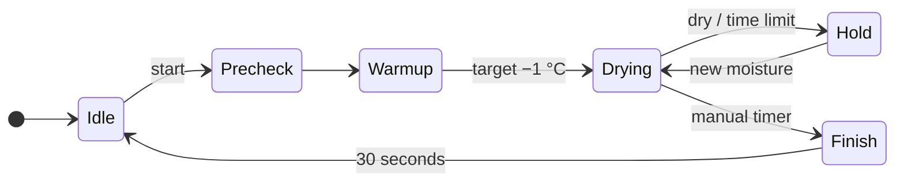

# FilamentDryer architecture

[Русская версия](ARCHITECTURE.RU.md) · [Project overview](../README.md) ·
[Measurements](MEASUREMENTS.md)

This describes firmware **0.2.2** for the ESP32-WROOM-32D. The chamber holds two
spools; temperature and humidity control share the same state with the local
screen and web panel. Wi-Fi availability does not select the drying mode.

## Hardware and readings

The pin definitions are in [BoardConfig.h](../include/config/BoardConfig.h).

| Function | GPIO | Implementation |
|---|---:|---|
| I²C SDA / SCL | 21 / 22 | AHT30 at `0x38`, SH1106 at `0x3C`, 400 kHz |
| Encoder A / B / button | 32 / 33 / 25 | local menu input |
| Heater MOSFET | 26 | 24 V PTC, on/off under the thermostat |
| Fan MOSFET | 27 | two 24 V fans, 20 kHz, 10-bit PWM |
| Vent servo | 14 | separate 5–6 V supply, 50 Hz |
| Heater NTC | 34 | ADC1, 10 kΩ at 25 °C, Beta 3950 |
| HX711 #1 DOUT / SCK | 16 / 17 | spool one |
| HX711 #2 DOUT / SCK | 18 / 19 | spool two |

The hardware design includes a 120 °C thermal fuse in series with the heater.
MOSFET gate pull-downs keep the power stages off while the ESP32 resets.

The NTC divider is `3.3 V → fixed resistor → ADC → NTC → ground`. The driver
uses a **3.6 kΩ** fixed resistor, `ADC_11db` and the ratio from `analogRead()`:

```text
r = raw / 4095
R_NTC = 3600 × r / (1 − r)
T_K = 1 / (1 / 298.15 + ln(R_NTC / 10000) / 3950)
T_C = T_K − 273.15
```

Near-rail ADC values and temperatures outside the driver's accepted range produce
an invalid reading. These constructor values come from
[Defaults.h](../include/config/Defaults.h). AHT30 readings include temperature,
relative humidity, absolute humidity and a validity flag. Each HX711 uses an
eight-reading median before conversion to grams.

## Services and scheduling

`src/main.cpp` assembles drivers, services and one `DeviceState` object. Hardware
drivers implement the interfaces in `include/domain/Interfaces.h`; the control
core can therefore run in host tests with mock outputs.



The main loop schedules these nominal periods:

| Work | Period |
|---|---:|
| NTC and weight polling | 100 ms |
| Control, calibration, actuator application | 100 ms |
| Air sensor polling | 1 s |
| Local screen rendering | 250 ms |
| AH samples inside an eligible window | 30 s |
| LittleFS telemetry | 60 s |
| Serial diagnostics | 5 s |

Local input, Wi-Fi, ArduinoOTA and the HTTP server are serviced from the same
loop. Their calls share the task with the controller. The task watchdog is
configured for five seconds.

## Temperature cascade

The outer controller uses chamber air temperature as feedback and outputs a
**heater-temperature setpoint**. The inner thermostat compares this setpoint with
the heater NTC and requests either 0% or 100% heat.

The active air target is the drying target, or `holdTemperatureC` in `Hold` when
that value is positive. The normal heater ceiling is the lower positive preset
and configuration limit minus 5 °C. `ControlService` also keeps this ceiling at
least 1 °C above the air target so the PID has an output range.

The project's `PidController` limits its output and integral, computes the
derivative from the input, and applies anti-windup. A changed temperature range
resets the PID and thermostat. The thermostat has a ±1 °C band and a two-second
minimum switching interval; the safety gate can turn heating off independently.

## Pulse ventilation

`PurgeScheduler` follows three phases. The numeric values also appear in
`dryness.purgePhase` in the API.

| Phase | Value | Vent | Fan demand |
|---|---:|---|---|
| `Sealed` | 0 | closed | circulation duty |
| `Purge` | 2 | open | purge duty |
| `Settle` | 1 | open | purge duty |

After the minimum sealed interval, ventilation starts when AH has risen by at
least **0.5 g/m³** from its sealed baseline, or has reached
`AH(active air target, target RH) + 3 g/m³`. The first purge may start immediately
to exchange the initial air.

`Purge` ends when AH is below that latter threshold or the purge duration cap
expires. `Settle` keeps the vent open for its configured duration, then closes it
and captures a new AH baseline. Comments in the original design described a
closed settling phase; the current output policy keeps it open.

Active fan duty is at least the larger of the configured floor and 25%.
Ventilation scheduling continues independently of the AH measurement-window
deadline.

## Moisture-release measurement

Absolute humidity (AH) expresses water vapour in g/m³. In a closed chamber near a
steady temperature, its rate of change provides an estimate of moisture released
by the filament. `HumidityMath` converts the AHT30 temperature and relative
humidity using saturation vapour pressure and the ideal-gas relation.

`AhSlopeEstimator` fits a line to AH versus time and reports its slope in
g/m³/hour. It stores up to 40 samples and uses times relative to the newest
sample when computing the regression.

An eligible window needs `Drying` or `Hold`, a closed vent, and chamber air
within ±1 °C of its active target. Its first sample is taken immediately; later
samples arrive every 30 seconds. A slope needs at least eight samples, spanning
at least 210 seconds.

```text
window duration = max(minSealSeconds × 1000, 7 × 30000) milliseconds
quiet window    = valid slope < drynessSlopeGm3PerHour
wet window      = valid slope ≥ drynessSlopeGm3PerHour
```

The time deadline completes an eligible window without opening the vent. A real
`Sealed → Purge` transition can also complete a window with enough samples.
Coincident events produce one evaluation. A quiet evaluation increments
`drynessChecks`; a wet evaluation clears it. Incomplete windows produce neither
result. Ventilation itself does not erase completed evidence.

Leaving the temperature band, opening the vent or pausing discards the unfinished
window. A fresh run and a change between `Drying` and `Hold` reset the measurements
and consecutive-window count. This keeps warm-up and cooling samples out of the
next temperature regime.

The initial preset threshold is **0.3 g/m³/hour**. It and the timing values are
starting values for the [measurement procedure](MEASUREMENTS.md). Weight readings
are independent telemetry and are not required for this criterion.

## Modes and transitions

The core transitions are implemented in
[DryingStateMachine.cpp](../src/core/DryingStateMachine.cpp).



- **Preset:** at least the minimum drying time and two consecutive quiet windows
  permit `Hold`. The maximum time also selects `Hold`. Time is counted from the
  end of warm-up, excluding pauses.
- **Hold:** the air target drops to the preset storage temperature. A new quiet
  window arms moisture detection; a later wet window requests a fresh drying
  episode. A zero old counter cannot restart the cycle by itself. A zero dryness
  threshold disables both early completion and automatic re-drying.
- **Manual:** the countdown ends in `Finish`, regardless of the dryness counter.
- **Continuous:** conditions are maintained until a stop command.
- **Pause:** saves `Warmup`, `Drying` or `Hold` for resume; the incomplete
  measurement window is discarded.
- **Stop:** selects `Cooldown` and then `Idle` after 30 seconds. A new explicit
  start selects `Precheck` and clears the previous fault.

`Calibration` is an internal mode used by the weight-calibration service.
Material presets and their minimum/maximum durations are compiled in
[AppConfig.cpp](../src/config/AppConfig.cpp). `GET /api/config` lists them;
changing the compiled preset table requires a firmware build.

## Output policy and safety

`SafetyService` checks valid, finite air and heater readings, the heater limit and
the air ceiling. Missing load cells do not block heating. Default ceilings are
105 °C for the heater and 75 °C for the air.

`ActuatorService` applies fan output before heater output and raises requested
fan duty to its startup-configured floor whenever heat is requested. This is a
software invariant about commands; the hardware has no airflow feedback.

| Situation | Heater | Fan | Vent |
|---|---:|---:|---|
| `Idle`, `Paused`, established `Fault` | off | off | safe angle |
| `Finish`, `Cooldown` | off | 60% | safe angle |
| Safety check detects a fault | off | 100% for that update | safe angle |
| Controller observes OTA in progress | off | 60% | safe angle |

On the update following fault detection, the established `Fault` output policy
applies. The independent thermal fuse and gate pull-downs belong to the hardware
design. Fault enums also contain planned cases; the current safety evaluator
does not implement warm-up timeouts or convert storage failures into faults.

## Web API and persistent data

Both interfaces work on the same state machine. API handlers delegate commands
to services; they do not run a separate control algorithm.

| Method and path | Behavior |
|---|---|
| `GET /api/state` | full live state, version, readings, setpoints, outputs and dryness |
| `GET /api/config` | exposed settings and compiled presets; passwords omitted |
| `PUT /api/config` | exposed network, authentication, time, temperature, fan and scale settings |
| `POST /api/run` | preset, manual or continuous start |
| `POST /api/pause` | toggle pause/resume |
| `POST /api/stop` | stop and cool down |
| `GET /api/history` | current telemetry JSONL file |
| `GET /api/events` | current event JSONL file |
| `GET/POST /api/calibration` | scale status or tare/scale/drift action |
| `GET /api/scan` | start or collect asynchronous Wi-Fi scan |
| `POST /api/reboot` | reboot |
| `POST /api/ota` | multipart firmware upload |

Example run bodies are `{"mode":"timed_preset","preset":"pla"}` and
`{"mode":"timed_manual","temperatureC":45,"durationSeconds":21600}`.
Configuration updates are saved and return `rebootRequired`; a restart completes
application of startup-configured settings. Preset dryness thresholds and timing
are not writable through this endpoint.

Preferences/NVS stores individual configuration keys and the two weight
compensation tables. Runtime mode, pending moisture events and measurement
windows are held in RAM. The storage service migrates the original binary
configuration blob to the key-value layout.

LittleFS contains the web assets, `/telemetry.jsonl` and `/events.jsonl`.
Each log rotates at 300,000 bytes to one `.old` file. History and event endpoints
return the current files in full. Telemetry is written every 60 seconds and
includes `ts`, optional `epoch`, `t`, `rh`, `ah`, `ntc`, `w1`, `w2`, `heat`,
`fan`, `vent`, `pph` and `slope`. Full state capture is used for experiments
because it also contains the drying phase, slope sample count and quiet-window
counter.

## Network, first setup and OTA

With no saved network, Wi-Fi stays off; with saved credentials, the station
connects and retries independently of the drying mode. `WIFI SETUP → Start` or a
held encoder button at boot opens `dryer-setup-XXXX`. Its per-boot random WPA2
password is shown on the screen and serial console. Setup runs for ten minutes;
another request renews the window. The setup page is at `http://192.168.4.1`.

On the home network the default address is `http://dryer.local`. NTP adds Unix
timestamps when synchronized; the default display offset is UTC+3. An empty web
password leaves the local panel and OTA open. A configured password enables HTTP
Basic authentication, with `admin` as the fallback login, and also protects
ArduinoOTA.

Development uses PlatformIO Core 6.2.0. In a Python 3.11+ virtual environment,
`python -m pip install -r requirements-dev.txt` installs the pinned build and
plotting tools. Initial installation uploads both firmware and web assets:

```sh
pio run -e esp32dev -t upload
pio run -e esp32dev -t uploadfs
```

Later firmware updates use the panel or ArduinoOTA:

```sh
pio run -e esp32dev_ota -t upload
pio run -e esp32dev_ota -t upload --upload-port 192.168.1.238
```

For password-protected ArduinoOTA, the local PlatformIO configuration supplies
the uploader's `--auth` argument through `upload_flags`. The web panel accepts
`firmware.bin` through a multipart upload. ArduinoOTA transfers are blocking: its callbacks temporarily
remove the main task from the watchdog and restore it after completion or error.
The OTA flag suppresses LittleFS telemetry writes while a transfer is active.

The [4 MB partition table](../partitions_ota_4mb.csv) provides two application
slots and LittleFS. Automatic boot confirmation and rollback were part of the
initial design; the current firmware uses the Arduino OTA mechanisms above.

## Verification and design history

Host tests in [test_logic.cpp](../test/test_native/test_logic.cpp) exercise
humidity conversion/regression, temperature bounds, thermostat switching, fan
command ordering, ventilation timing and state transitions. Python tests check
capture against a local HTTP server and plotting with synthetic fixtures. CI
also builds both production firmware profiles and the LittleFS image. The
`esp32dev_test` profile disables NTC checks for bench work and is excluded from
production artifacts.

The initial architecture proposed direct heater-power PID, an RH PID,
QuickPID/HX711_ADC and a timer-only completion path. The implementation uses a
local PID plus heater thermostat, pulse ventilation, bogde/HX711 and AH-based
completion with storage monitoring. Version 0.2.2 separates measurement-window
completion from purges and makes re-drying depend on fresh measurements in
`Hold`.
